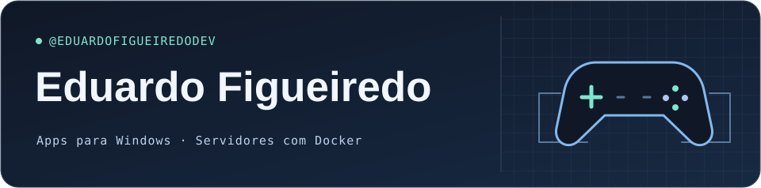

  

  
  

## O que eu faço

Sou o Eduardo, de Poços de Caldas, MG. Criei o **GamePad Lite** pra ajustar como o controle responde no Windows, com perfis pra guardar as configurações de cada jogo. Também mantenho uma configuração em Docker pra subir um servidor de Minecraft modificado.

## Tecnologias nos projetos

| Apps para Windows | Infraestrutura de jogos |
| --- | --- |
|    |    |

## Projetos

### 🎮 GamePad Lite

Um app para Windows 10 e 11 que permite emular um controle Xbox, ajustar curvas e zonas mortas dos analógicos e configurar vibração e iluminação em controles compatíveis. Jogos e mods também podem enviar efeitos ao app via UDP.

[**Guia e compatibilidade**](https://github.com/eduardofigueiredodev/gamepad-lite-releases) · [Histórico de versões](https://github.com/eduardofigueiredodev/gamepad-lite-releases/releases) · [Reportar um bug ou sugerir uma ideia](https://github.com/eduardofigueiredodev/gamepad-lite-releases/issues)

### ☁️ All the Mods 10: To the Sky em Docker

O Docker Compose sobe o servidor do modpack ATM10SKY. O build busca o pacote no CurseForge e o volume do Docker guarda o mundo entre reinícios.

[**Ver o Dockerfile e o passo a passo**](https://github.com/eduardofigueiredodev/atm10tts-docker)

---

  <a href="https://github.com/eduardofigueiredodev?tab=repositories">Repositórios</a> ·
  <a href="https://github.com/eduardofigueiredodev#contribution-activity">Atividade no GitHub</a>

